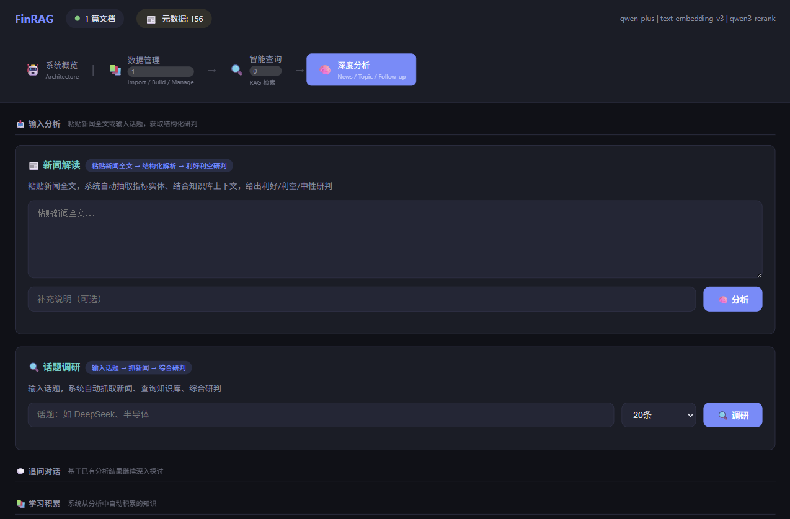
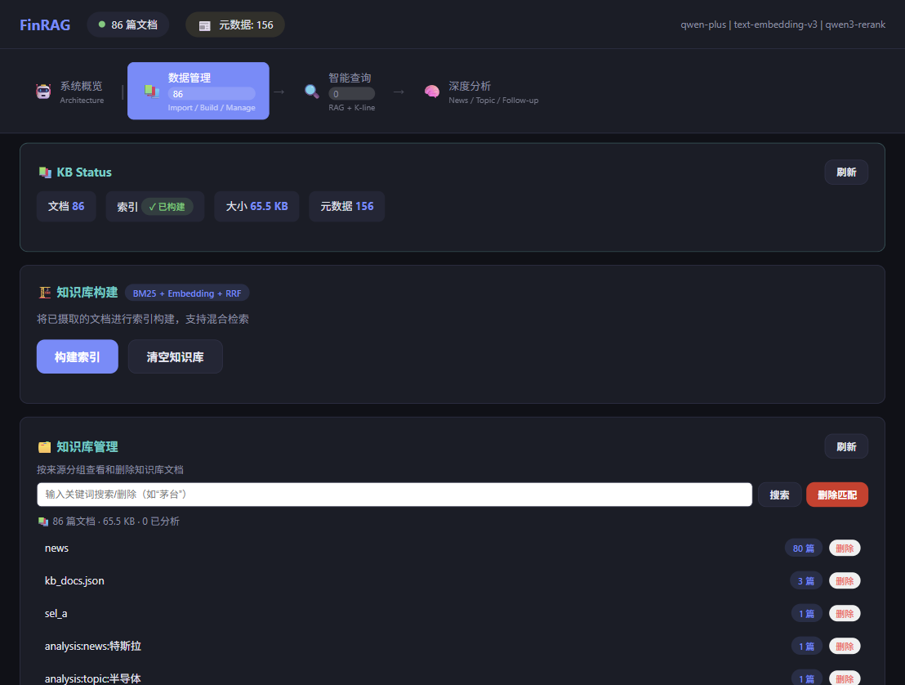
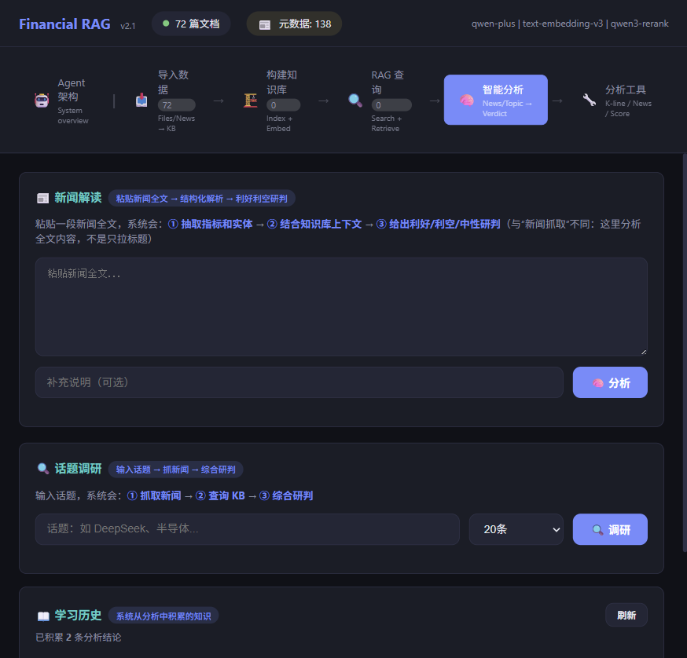
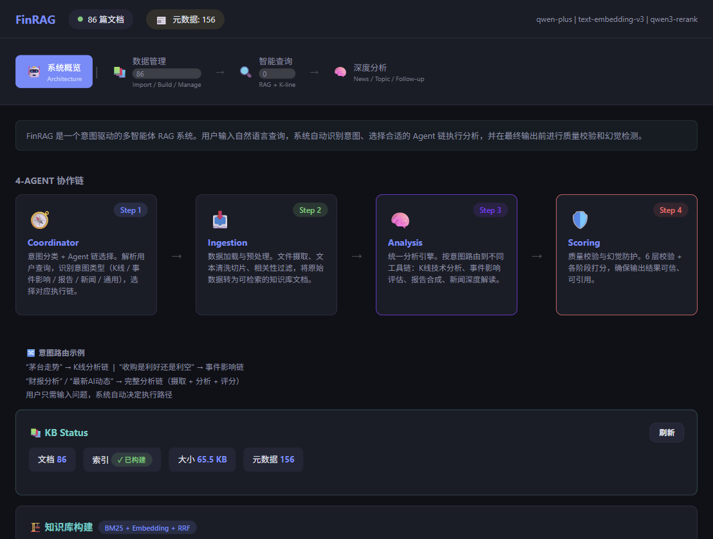

# FinRAG —— 面向 AI 板块的金融智能分析系统

把中国市场的 AI / 科技板块**新闻、研报、行情**，转化为**有据可查、经防幻觉校验**的结构化分析结论。

输入一个自然语言问题，系统自动完成：意图路由 → 混合检索 → LLM 分析 → 防幻觉校验 → 打分，返回带来源引用的判断。


---

## 它能做什么

| 场景 | 你输入 | 系统产出 |
|------|--------|----------|
| **新闻解读**（最高优先级） | 一条 AI 板块新闻 | 结论(利好/利空) + 关键信号 + 影响 + 风险 + 后续观察，逐条附来源引用 |
| **智能问答** | 自然语言问题 | 基于知识库、带 `[N]` 引用的有据回答 |
| **话题调研** | 一个赛道话题（如"AI 芯片"） | 多源综合的结构化调研报告 |
| **K线技术分析** | 一个股票代码（如 600519） | MACD/RSI/KDJ/BOLL 指标 + LLM 走势解读 |
| **文档入库** | 拖拽 PDF / 图片 / 文本 | 解析 → 切分 → 建索引，进入可检索知识库 |

所有结论都经 **L1-L4 确定性防幻觉护栏**校验（来源有据 / 数值保真 / 引用完整 / 结构合规，零 LLM、毫秒级），并附质量评分。

<p align="center">
  
  <em>深度分析面板：新闻解读 / 话题调研的结构化结论</em>
</p>

<p align="center">
  
  <em>知识库管理：导入文件、构建索引（BM25 + embedding + RRF）、搜索 / 删除</em>
</p>

---

## 快速开始

```bash
# 1. 克隆
git clone <your-fork-url> && cd financial-rag

# 2. 装依赖、建环境（推荐 uv，按 uv.lock 精确复现）
uv sync --extra dev
.\.venv\Scripts\Activate.ps1        # Windows PowerShell；macOS/Linux: source .venv/bin/activate

# 3. 配置 API key
cp .env.example .env                # 编辑 .env 填入 DASHSCOPE_API_KEY

# 4. 启动 Web UI
python -m financial_rag.main web    # 打开 http://127.0.0.1:8000（暗色主题，4 Tab 侧边栏导航）
```

命令行方式：

```bash
python -m financial_rag.main pipeline "这周 AI 圈发生了什么？"
python -m financial_rag.main pipeline "看下 600519 的 MACD" -v
python -m financial_rag.main toolcall -l    # 列出全部已注册工具
```

> 无 uv 时的兼容旧流程：`python -m venv myenv` → 激活 → `pip install -r requirements.txt`。

---

## 一个真实示例

**输入**：`这周 AI 圈发生了什么？`

**系统流程**：意图路由（新闻深读）→ 混合检索知识库做 grounding → LLM 结构化分析 → 防幻觉护栏校验 → 质量打分

**输出**（结构化结论）：

- `verdict` —— 本周基调（利好 / 利空 / 中性）
- `key_signals` —— 关键信号，逐条列出
- `impact` —— 影响面分析
- `risks` —— 风险提示
- `watch_next` —— 后续观察点
- 每条结论附 `[N]` 来源引用 + 一份防幻觉校验报告

<p align="center">
  
  <em>智能查询面板：混合检索 + K 线技术分析</em>
</p>

---

## 架构概览

```
用户层     FastAPI Web UI（4 Tab：系统概览 / 数据管理 / 智能查询 / 深度分析）+ CLI
   │
调度层     AgentRouter（意图 → Agent 链） · PipelineScheduler（5 阶段执行）
   │
Agent 层   Ingestion（摄取） → Analysis（分析） → Scoring（评分 + 防幻觉）
   │
能力层     38 个已注册工具（分析 / 数据 / KB / 抽取 / 检索）
   │
基础设施   混合检索(BM25 + Chroma + RRF + Rerank) · DashScope Qwen · L1-L4 防幻觉 · KB
```

Agent 只做编排，业务逻辑全部委托给工具（`call_tool()`），由架构守卫规则强制。

<p align="center">
  
  <em>3-Agent 链：Ingestion → Analysis → Scoring，由 AgentRouter 做意图路由</em>
</p>

**完整架构、五条业务通路、Agent / 工具清单、Backlog 见 [docs/ARCHITECTURE.md](docs/ARCHITECTURE.md)（唯一权威基准）。**

---

## 技术栈

| 层 | 选型 |
|----|------|
| LLM / Embedding / Rerank | DashScope Qwen（默认 qwen-plus）· text-embedding-v3 · qwen3-rerank |
| 检索 | BM25(SQLite FTS5) + ChromaDB 向量 + RRF 融合 + Rerank + 查询扩展 |
| 后端 / 前端 | FastAPI + async 路由 · 原生 JS ES Modules + 暗色主题 UI |
| 数据源 | Tushare · 同花顺 · 新浪 · 东方财富 |
| 图谱 RAG（可选，默认关闭） | LightRAG 知识图谱，需源码安装并设 `LIGHTRAG_ENABLE=true` |
| 可观测性（可选，默认关闭） | Arize Phoenix（OpenInference/OTel，独立 `.venv-obs` + OTLP 外推） |
| 依赖管理 | uv + `pyproject.toml`（单一真相源）+ `uv.lock`（可复现） |

---

## 项目状态

**V1.0 —— 能用但粗糙，正在做 TDD 护栏加固。**

功能面已铺开（多 Agent 路由、混合检索、图谱 RAG、Web UI），但质量正一步步用测试度量、而非用文字断言：RAG 流水线 Step 0-7 已逐步验证，**314 个离线测试**（无需 API key）钉住已修复的回归。加固期内 CI 门禁临时改为手动触发。

---

## 开发与测试

```bash
python -m pytest tests/ -q          # 314 passed，离线，无需 API key
python -m financial_rag.eval.runner # L1 检索评估：分通道 IR 指标 + 基线回归锁
```

测试按 RAG 流水线步骤组织，每条遵循「从代码契约推导应然 → 探针对真实组件观测实然 → 对照修复 → 固化为永久回归测试」。只 mock 数据源 API；检索被强制离线(BM25 + Jaccard)保证确定性；LLM / embedding / rerank 仅在测试显式调用时才真实。

依赖用 [uv](https://docs.astral.sh/uv/) 管理，`pyproject.toml` 是单一真相源：

```bash
uv sync --extra dev              # 建 .venv，装 core + dev
uv sync --extra observability    # 追加 OTLP 导出器（启用 Phoenix 埋点时需要）
uv run pytest tests/             # 在项目环境里跑测试
```

> 国内网络：uv **不读** pip 的镜像配置，需另配 `%APPDATA%\uv\uv.toml`（Linux/macOS：`~/.config/uv/uv.toml`）把默认索引设为清华镜像，否则直连 pypi.org 解析大依赖树会长时间卡住。

---

## 文档

- **[docs/ARCHITECTURE.md](docs/ARCHITECTURE.md)** —— 唯一架构基准：业务通路、Agent / 工具清单、Backlog
- **[docs/OPTIMIZATION_ROADMAP.md](docs/OPTIMIZATION_ROADMAP.md)** —— 优化路线图

---

## 许可证

MIT
