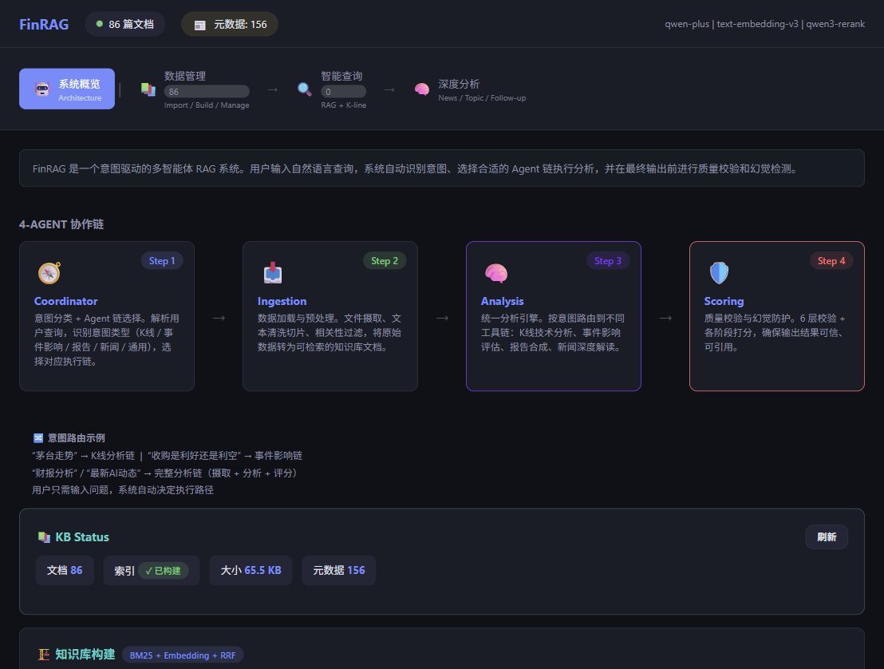
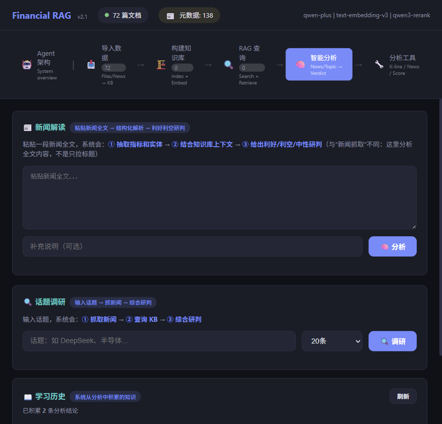
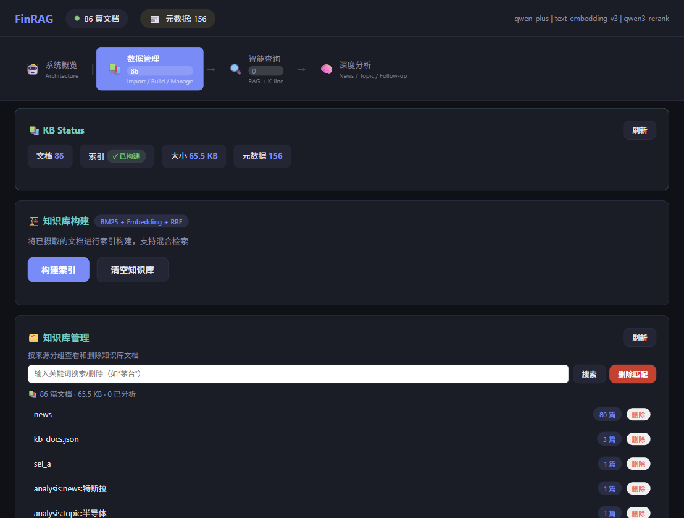

# FinRAG — Multi-Agent RAG for Chinese Financial / AI-Sector Queries

Query → intent routing → agent chain → hybrid retrieval → grounded answer with a hallucination guard. Built for the AI sector of the Chinese market (stocks, news, research).

> ### ⚠️ Honest status: V1.0, under active TDD hardening
>
> V1.0 is a **working but rough** product. It shipped a lot of surface area fast — multi-agent routing, hybrid retrieval, graph RAG, a web UI — but **quality was asserted in prose, not measured by tests**. The RAG pipeline had essentially *no* end-to-end verification.
>
> **The current mission is TDD.** We are retro-fitting a test harness that walks the RAG pipeline **one step at a time**: derive each step's contract, verify real behavior against it, fix what breaks, and lock the fix as a permanent regression asset. No big-bang rewrites. This README reflects that reality instead of overselling.


---

## Current Mission — Harness-Driven Hardening

**The method (repeated for every RAG pipeline step):**

1. **Derive "should-be"** from the code contract — the spec, not a guessed answer.
2. **Probe "as-is"** with a throwaway script against the real components.
3. **Reconcile.** Where should-be and as-is diverge → a real defect, not a hypothetical.
4. **Fix in place**, then **crystallize the probe into a permanent test.**

**Four standards every test must meet:**

| Standard | Meaning |
|----------|---------|
| ① Prove effect | assert behavior/outcome, not just shape or "didn't crash" |
| ② Observable | the thing under test emits a trace / assertable output |
| ③ Consistent | same input → same output; deterministic and offline |
| ④ Regression-locked | fixed bugs pinned so they can't silently return |

**Pipeline coverage so far:**

| # | RAG step | Status | Test asset |
|---|----------|--------|-----------|
| 1 | Ingest — chunk + index | ✅ verified | `tests/test_ingest_step1.py` (6) |
| 2 | Query parsing | ✅ verified · 1 bug found & fixed | `tests/test_query_parser_step2.py` (21) |
| 3 | Recall — BM25 + vector | ⬜ not started | — |
| 4 | RRF fusion | ⬜ not started | — |
| 5 | Rerank | ⬜ not started | — |
| 6 | Filter / quality gate | ⬜ not started | — |
| 7 | Generation grounding | ⬜ not started | — |

Plus the context-assembly layer: `tests/test_context_builder.py` (9).

**Total: 36 passing — offline, no API key needed.** Tests force local retrieval (BM25 + Jaccard) via a `conftest` fixture, so they are deterministic and network-free. LLM/embedding stay real only where a test explicitly exercises them; external data APIs are mocked.

**First real bug the harness caught (Step 2):**

> `_extract_stock`'s 6-digit regex grabbed the first 6 digits of an 8-digit date (`YYYYMMDD`), so `"20240601"` was misparsed as `stock_code="202406"`, polluting downstream filtering/routing. Fixed with digit boundaries `(?<!\d)(\d{6})(?!\d)`; locked by a regression test that turns red if the old behavior ever returns.

---

## What's in the Box (V1.0 features — built; verification in progress)

These exist in code. They are **not** yet all covered by the harness — closing that gap is the work in progress above.

- **Intent routing.** `AgentRouter` classifies a query into an intent and assembles the matching agent chain (Ingestion / Analysis / Scoring). No manual pipeline selection.
- **Thin agents, fat tools.** Agents only orchestrate via `self.call_tool()`; business logic lives in registered tools across 11 tool modules. Enforced by an architecture-guard rule.
- **Hybrid retrieval.** BM25 + ChromaDB vector search + RRF fusion + rerank + metadata filtering + query expansion. *Retrieval quality is exactly what the harness is being built to measure — it is not yet verified.*
- **Query planning.** `QueryPlanner` uses one LLM call to decompose complex queries into source/mode-aware sub-queries; simple queries skip it.
- **Hallucination guard.** ScoringAgent runs a multi-layer guard (rule layers: source grounding, numerical fidelity, citation integrity, structure compliance; plus LLM critique/assist) before a result is returned.
- **Observable context assembly.** A single `ContextBuilder` turns retrieved chunks into the grounding fed to both the LLM and the guard, and emits a fidelity trace (per-item kept/dropped with reasons). Covered by tests.
- **Graph RAG.** LightRAG knowledge graph wired into ingestion; queried on demand via function-calling tools, routed by `QueryPlanner`'s `source: graph`.
- **Multi-modal parsing.** PDF via PyMuPDF (local, no API), images via qwen-vl-plus.
- **Web UI + CLI.** FastAPI dark-theme UI (drag-and-drop file upload, KB management, dual-mode query) and a CLI.
- **Extensible dictionaries.** `DictionaryRegistry` merges external JSON from `data/dictionaries/` — coverage grows without a code change.
- **Resilient LLM layer.** `LLMCaller` wraps every call with retry, JSON repair, and response caching.

---

## Architecture

```
┌──────────────────────────────────────────────────────────────┐
│  User Layer — FastAPI web UI (dark theme) + CLI             │
└────────────────────────────┬─────────────────────────────────┘
                             │
┌────────────────────────────▼─────────────────────────────────┐
│  Scheduling — AgentRouter (intent → chain)                  │
│               PipelineScheduler (5-phase execution)          │
└────────────────────────────┬─────────────────────────────────┘
                             │
┌────────────────────────────▼─────────────────────────────────┐
│  Query Planning — QueryPlanner (LLM decomposition)          │
│   complex queries → sub-queries with source + mode           │
└────────────────────────────┬─────────────────────────────────┘
                             │
┌────────────────────────────▼─────────────────────────────────┐
│  Agents (3)                                                  │
│  Ingestion    → fetches and indexes source documents         │
│  Analysis     → routes to tools by intent, assembles result  │
│  Scoring      → hallucination guard + quality evaluation     │
└────────────────────────────┬─────────────────────────────────┘
                             │
┌──────────┬─────────────────┬─────────────────────────────────┐
│ Retrieval│ Data APIs       │ LLM Layer                        │
│ BM25+Chroma│ Tushare         │ LLMCaller (retry+cache+JSON)    │
│ RRF+Rerank│ 10jqka/Eastmoney│ ModelRouter (4 tiers, Qwen)    │
│ +Graph   │ LightRAG (integrated) │                                  │
└──────────┴─────────────────┴─────────────────────────────────┘
```

---

## How Routing Works

The AgentRouter classifies each query into an intent, then the scheduler assembles the agent chain:

| Intent | Example Query | Chain |
|--------|---------------|-------|
| K-line analysis | "Show me the MACD for 600519" | Analysis → Scoring |
| Event impact | "Is this acquisition good or bad?" | Analysis → Scoring |
| Report synthesis | "Summarize Q4 earnings" | Ingestion → Analysis → Scoring |
| News deep-dive | "What happened in AI this week?" | Analysis (deep) → Scoring |
| Topic research | "Research the AI chip sector" | Analysis (deep_topic) → Scoring |
| General | anything else | Ingestion → Analysis → Scoring |

The user types a natural-language question; the system decides the rest.

---

## Tech Stack

| Layer | Technology |
|-------|-----------|
| LLM | DashScope Qwen (turbo / plus / max / 235b) |
| Embedding | text-embedding-v3 (1024-dim) |
| Rerank | qwen3-rerank (fallback to RRF score) |
| Backend | FastAPI + 4 async routers + python-multipart (file upload) |
| Frontend | Vanilla JS ES Modules (9 modules) + 6 layered CSS + collapsible cards |
| Data APIs | Tushare, 10jqka, Sina, EastMoney |
| Retrieval | BM25 + ChromaDB (ANN) + RRF + TextChunker + QueryParser (synonym + concept dictionaries) |
| Query Planning | QueryPlanner (LLM decomposition, source/mode-aware sub-queries) |
| Document Parse | PyMuPDF (PDF, local) + qwen-vl-plus (image multimodal) |
| Graph RAG | LightRAG (PDF/image → entity-relation extraction → graph query via function calling) |
| Domain Dicts | DictionaryRegistry (JSON-extensible: `data/dictionaries/*.json`) |
| Vector DB | ChromaDB (HNSW ANN, cosine distance, persistent storage) |
| Testing | pytest — harness-driven, per-pipeline-step (36 passing, offline); CI gate temporarily manual-only during hardening |

---

## Quick Start

```bash
# 1. Clone and setup
git clone <your-fork-url>
cd financial-rag

# 2. Create virtual environment
python -m venv myenv

# Activate
# Windows (PowerShell):
.\myenv\Scripts\Activate.ps1
# macOS/Linux:
source myenv/bin/activate

# 3. Install dependencies
pip install -r requirements.txt

# 4. Configure API key
cp .env.example .env
# Edit .env and fill in DASHSCOPE_API_KEY

# 5. Launch web UI
python -m financial_rag.main web
# Opens at http://127.0.0.1:8000 — dark theme, sidebar navigation
# Upload PDF/images via drag-and-drop in the Data Import panel

# 6. Or use CLI
python -m financial_rag.main pipeline "What happened in AI this week?"
python -m financial_rag.main pipeline "Show me MACD for 600519" -v
python -m financial_rag.main toolcall -l   # list all registered tools
```

---

## Testing

```bash
python -m pytest tests/ -v    # 36 passing — offline, no API key needed
```

The suite **is** the harness described above: per-step, contract-derived, effect-proving tests with regression locks. It grows **one pipeline step at a time** — full RAG-chain coverage is intentionally incomplete (verify a step, then move to the next). The CI gate is temporarily manual-only (`workflow_dispatch`) during this hardening phase.

Tests mock only **data sources** (Tushare, news APIs). Retrieval is forced offline (BM25 + Jaccard) for determinism; LLM/embedding/rerank stay real only where a test explicitly exercises them.

---

## Documentation

- **[Architecture Docs (中文)](docs/ARCHITECTURE.md)** — the single source of truth: business paths, agent/tool inventory, backlog

---

## UI (V1.0)

<p align="center">
  
  <em>3-agent chain: Ingestion → Analysis → Scoring, with AgentRouter intent-based routing</em>
</p>

<p align="center">
  
  <em>Query panel: hybrid retrieval + K-line technical analysis</em>
</p>

<p align="center">
  
  <em>Knowledge base management: import files, build indexes (BM25 + embedding + RRF), search/delete</em>
</p>

---

## License

MIT
