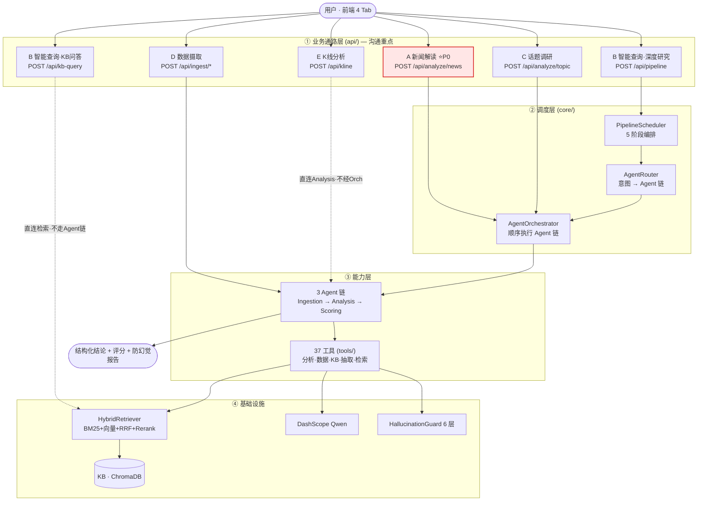

# FinRAG 架构基准

> **本文件是项目唯一架构文档**（2026-10 重写，取代已删除的 ARCHITECTURE_CN / AGENT_TOOLS / PROJECT_QA / USER_GUIDE）。
> 纪律：**代码即真理**。本文与代码冲突时以代码为准，并立即修正本文。任何调度层/通路改动必须同步本文件。

---

## 1. 项目定位

面向 AI/科技行业的金融智能分析系统（意图感知多智能体 RAG）。
核心业务：**新闻解读**（最高优先级）、话题调研、K线技术分析、知识库问答。
技术栈：FastAPI + DashScope(Qwen) + ChromaDB + 自研 HybridRetriever + LightRAG 图谱。

## 2. 总体架构

```
┌─ 前端 (static/) ─────────────────────────────────────────────┐
│  4 Tab: 系统概览 | 数据管理 | 智能查询 | 深度分析              │
│  index.html + app.js + modules/(9个ES模块)                   │
└──────────────────────────┬───────────────────────────────────┘
┌─ API 层 (api/) ──────────▼───────────────────────────────────┐
│  analysis_router | kb_router | ingest_router | query_router  │
│  app_state: 全局单例 (_state: llm/retriever/registry/        │
│             orchestrator/scheduler/filler/conversation_mgr)  │
└──────────────────────────┬───────────────────────────────────┘
┌─ 调度层 (core/) ─────────▼───────────────────────────────────┐
│  AgentRouter     意图分类(关键词+正则) → Agent 链             │
│  PipelineScheduler  5阶段: Fetch→Index→Process→Output→Evolve │
│  AgentOrchestrator  顺序执行链 + AgentContext 数据流          │
└──────────────────────────┬───────────────────────────────────┘
┌─ Agent 层 (agents/) ─────▼───────────────────────────────────┐
│  IngestionAgent → AnalysisAgent → ScoringAgent   (共3个)     │
│  Agent 只做编排，重活全部 call_tool() 委托                    │
└──────────────────────────┬───────────────────────────────────┘
┌─ 工具层 (tools/) ────────▼───────────────────────────────────┐
│  FunctionRegistry: 37 tools / 11 模块 / 5 分类               │
└──────────────────────────┬───────────────────────────────────┘
┌─ 基础设施 ───────────────▼───────────────────────────────────┐
│  retrievers/ 混合检索(BM25 FTS5+Chroma+RRF+Rerank+扩词)      │
│  llm/ DashScope客户端+ModelRouter   guard/ 6层防幻觉          │
│  services/ 分析·会话·持久化          slot_filler+templates    │
└──────────────────────────────────────────────────────────────┘
```

## 3. 业务通路（P0 — 一切工作围绕这些通路）

### 业务实现总览图（Mermaid，IDE 预览可渲染）



> **看图说话**：5 条业务通路从 API 入口进来 → 调度层决定走哪条 Agent 链 → 3 Agent 顺序执行、把重活委托给 37 工具 → 工具落在检索/LLM/防幻觉/KB 基础设施上 → 产出结构化结论+评分+防幻觉报告。
> ⭐ **A 新闻解读是 P0**（红框）；实线=走 Orchestrator 编排，虚线=旁路（KB问答直连检索、K线直连 AnalysisAgent）；深度研究(Bp) 独有 5 阶段 Pipeline。

### 通路 A：新闻解读 ⭐ 最高优先级
```
POST /api/analyze/news (analysis_router.py)
  → _run_analysis_via_agent_chain(intent="news", parsed_data=[{text}])
    → orchestrator.set_pipeline(["AnalysisAgent","ScoringAgent"]).execute()
      → AnalysisAgent._run_deep_news_chain → call_tool("analyze_news_deep")
        (内部: KB检索 grounding + LLM 结构化分析 → verdict/key_signals/impact/risks/watch_next)
      → ScoringAgent → evaluate_pipeline_quality ‖ check_hallucination → generate_score_report
  → 链失败 fallback: services/analysis.analyze_news_text + 独立 guard 校验
  → 后处理: 创建会话(conversation_manager) + 分析结论存入 KB
```

### 通路 B：智能查询（双模式）
```
KB问答:   POST /api/kb-query (kb_router.py)
  → retriever.search 混合检索 → LLM 生成带 [N] 引用答案
  → PipelineScoreCard + HallucinationGuard(mode=rag) 直连（不走 Agent 链）
深度研究: POST /api/pipeline (query_router.py)
  → scheduler.run() 5阶段:
    1 Fetch   FC会话选数据工具拉新闻 (需 LLM)
    2 Index   TextPreprocessor 清洗 → retriever 入库+检索
    3 Process AgentRouter.route(query) → 动态链 → orchestrator.execute()
    4 Output  SlotFiller 槽位填充（Agent 已有输出则跳过）
    5 Evolve  ScoreCard 打分 + Guard 防幻觉（报告追加到输出尾部）
```

### 通路 C：话题调研
```
POST /api/analyze/topic → _run_analysis_via_agent_chain(intent="deep_topic")
  → AnalysisAgent._run_deep_topic_chain → call_tool("analyze_topic_deep")
  ⚠️ deep_topic 不在 AgentRouter 意图表里，由 API 直接注入（历史旁路）
```

### 通路 D：数据摄取
```
新闻:  POST /api/ingest/news → tools/news_tools.run_news_pipeline
       (RSS/同花顺/新浪/东财 → 元数据 news_metadata.json；优质新闻入 KB)
文件:  POST /api/ingest/files | /api/ingest/upload (拖拽上传)
       → IngestionAgent: JSONL/TXT/PDF(PyMuPDF)/图片(qwen-vl) →
         清洗 → 相关性门控 → 分类 → extract_document_metadata → KB
       → PDF/图片解析内容另送 LightRAG 图谱抽取实体关系
```

### 通路 E：K线技术分析
```
POST /api/kline → 直接实例化 AnalysisAgent (intent=kline)
  → analyze_kline(Tushare/模拟数据 + MACD/RSI/KDJ/BOLL) → generate_kline_analysis(LLM)
  ⚠️ 第三条编排入口（不经 orchestrator/不评分）
```

### 意图 → Agent 链映射（AgentRouter，core/agent_router.py）
| intent | 触发 | 链 |
|--------|------|-----|
| kline | 走势/MACD/涨跌… | Analysis → Scoring |
| event_impact | 利好/利空/大事… | Analysis → Scoring |
| report | 财报/营收/净利润… | Ingestion → Analysis → Scoring |
| news | 新闻/资讯/公告… | Ingestion → Analysis → Scoring |
| general | 兜底 (conf=0.5) | Ingestion → Analysis → Scoring |
| deep_topic | ⚠️ 仅 API 注入 | Analysis → Scoring |

链的真实区分度只有"是否带 Ingestion"；行为差异由 `metadata.intent` 驱动
AnalysisAgent 内部工具链分发（`_run_kline_chain` / `_run_event_chain` /
`_run_deep_news_chain` / `_run_deep_topic_chain` / `_run_extraction_chain`）。

## 4. 调度层执行语义

- **AgentContext**：raw_input / parsed_data / extracted_features /
  intermediate_findings / final_answer / metadata，Agent 间唯一数据通道。
- **context_updates 合并规则**（orchestrator._apply_updates）：
  dict 字段 merge、list 字段 extend、标量覆盖；未知 key 落入 metadata。
- **ScoringAgent 通用接口**：上游经 metadata 传
  `scoring_source_items` / `scoring_mode`("rag"|"analysis") / `scoring_text` 三字段即可接入评分。
- **防幻觉**：guard/reflector.HallucinationGuard，6 层（4 规则层 + LLM critique + LLM assist），
  RAG 模式查 `[N]` 引用，analysis 模式查 `【】` 结构。

## 5. Agent 清单（3 个，agents/）

| Agent | 职责 | 调用的工具 |
|-------|------|-----------|
| IngestionAgent | 文件/文本/目录摄取，清洗+门控+分类+元数据 | extract_document_metadata, detect_document_type, parse_pdf_file, describe_image_file |
| AnalysisAgent | 按 intent 分发 5 条工具链，渲染 Markdown | analyze_kline, generate_kline_analysis, fetch_date_events ‖ fetch_kline_context, assess_event_impact, analyze_news_deep, analyze_topic_deep, extract_financial_metrics ‖ extract_entities, generate_search_queries, synthesize_report |
| ScoringAgent | 全链路评分 + 防幻觉（所有链末端） | evaluate_pipeline_quality ‖ check_hallucination, generate_score_report |

（‖ = ThreadPoolExecutor 并行调用）

## 6. 工具清单（37 个 / 11 模块 / 5 分类，tools/）

| 分类 | 数量 | 工具 |
|------|------|------|
| analysis | 13 | analyze_news_deep, analyze_topic_deep, analyze_kline, generate_kline_analysis, assess_event_impact, synthesize_report, calculate_growth_rate, calculate_financial_ratio, compare_metrics, summarize_financials, evaluate_pipeline_quality, check_hallucination, generate_score_report |
| data | 9 | fetch_stock_news, fetch_financial_news, fetch_announcements, fetch_news_report, fetch_date_events, fetch_kline_context, fetch_kline_report, parse_pdf_file, describe_image_file |
| kb | 7 | kb_load, kb_save, kb_add, kb_remove, kb_stats, chunk_document, chunk_documents_batch |
| extraction | 5 | extract_document_metadata, detect_document_type, extract_financial_metrics, extract_entities, generate_search_queries |
| retrieval | 3 | search_financial_data, query_knowledge_graph, get_graph_stats |

模块文件：core / analysis_tools / news_tools / kline_tools / event_impact_tools /
kb_tools / chunk_tools / extraction_tools / document_parse_tools / report_tools /
scoring_tools / graph_tools（LLM 依赖经 inject_* 函数注入）。

## 7. 基础设施

- **retrievers/**（详见模块内 README）：HybridRetriever = BM25(SQLite FTS5 增量) +
  Chroma 向量 + RRF 融合 + qwen3-rerank + 查询扩展(词典 64 同义组/35 概念映射)；
  QueryPlanner(LLM 拆解复杂查询, 预留 source=graph)；TextChunker 按 doc_type 选策略
  (news 不切/长文按段落)；metadata.py 定义 DocMetadata schema + Chroma 白名单；
  lightrag_adapter 图谱检索。
- **llm/**：DashScopeLLM + LLMCaller(重试/缓存/JSON 平衡括号解析) + ModelRouter(4 档模型)。
- **services/**：analysis(新闻/话题分析 fallback 实现)、conversation(会话管理)、persistence(KB 持久化)。
- **数据**（data/knowledge_base/）：kb_docs.json(知识文档)、news_metadata.json(新闻元数据)、
  bm25_index.db(FTS5)、chroma/(向量库)、embedding_cache.json、conversations/、lightrag/。

## 8. 已知问题 & Backlog（业务通路优先，其余降级）

### P0 — 影响通路正确性（新架构跑通前必须处理）
1. **编排器并发竞态**：orchestrator 是共享单例，`set_pipeline()`+`self.context`
   为可变全局状态，并发请求互相覆写链与上下文（orchestrator.py L128/L151 ↔ pipeline.py L360 ↔ analysis_router.py L151）。
2. **防幻觉静默跳过**（可靠性层自己会被无痕绕过）：① `ScoringAgent.can_handle =
   bool(final_answer or intermediate_findings)`（scoring_agent.py L51-53），上游链忘写回
   final_answer → orchestrator 无痕 continue，整层评分+防幻觉消失且无"未校验"提示；
   ② `check_hallucination` 中 `if not check_text: return {}`（scoring_agent.py L101-102）
   → 待校验文本为空时静默跳过。二者均违反"防幻觉禁止静默跳过"（该规范只在 Guard
   内部 skip 落实，未覆盖"整层该不该跑"）。方向：can_handle 兜底 + 空文本走显式
   skipped 标记而非 return {}。**用户 2026-10 拍板：先记录，暂不动代码。**
3. **检索 grounding 被腰斩，RAG 名不副实**（探针实测）：深度分析路径把 KB 背景砍到
   `kb_sources[:3]` 且每条 `s['text'][:150]`（analysis.py L388 / L512）—— 实测召回 3286
   字 chunk 只喂进 450 字，**保真率 13.7%**，且每条断在半句/半词。后果连锁：AI 几乎拿不到
   真实 KB 上下文（只能靠新闻原文+先验）→ 幻觉温床；而 HallucinationGuard 又用**同一批
   150 字残片**当 grounding 打分 → answer 与"来源"同源于贫瘠输入 → **防幻觉分数系统性虚高、
   自我欺骗**。方向：grounding 组装统一走 ReliabilityService（见 P1-5），按 token 预算而非
   固定 150 字截断，优先保整句/整段。
4. **embedding 缓存 `text[:500]` 撞键 → 向量污染**（探针实测，静默数据损坏）：缓存键
   `MD5(text[:500])`（embedding_cache.py L200）。实测两 chunk 前 500 字相同（模板抬头/免责
   声明/重复段落）即得同一 hash `ec398a…` → 后者复用前者的 embedding → **存进错误向量** →
   检索召回错内容，静默难复现。方向：hash 用全文或 (source_id+chunk_id)。

### P1 — 通路跑通后第一批清理
5. **可靠性入口收敛 → 抽 ReliabilityService**（用户 2026-10 拍板方向·待开工）：
   `HallucinationGuard.check()` 现有 **4 个各自为政的调用点** —— ①链内 scoring_tools.
   check_hallucination（走 ScoringAgent）②analysis_router._run_hallucination_check（新闻/
   话题 fallback，硬编码 mode=analysis）③kb_router /kb-query（默认 mode=rag）④pipeline.
   _phase_evolve。每处自拼 sources、自定 mode、自决触发 → 同一输出走不同入口分数不可
   复现；通路 B 上 ①④ 对同一输出**双重评分**；改策略需同步 4 处易漂移（serializer
   注释仍写"统一 3 个调用点"，实为 4）。方向：抽 `ReliabilityService` 封装
   check()+mode 决策+source 组装+序列化，其余 3 处改为调它，ScoringAgent 亦复用。
6. 假分数：`evaluate_pipeline_quality` 硬编码 fetch=0.9/index=0.85/process=0.8
   （scoring_tools.py L63/70/79，"有数据即高分"）、`_phase_evolve` 硬编码 0.9/0.85/0.8
   → pipeline_grade 系统性虚高，应换真实质量信号（RAGAS 基线已建）。
   **另：L5/L6 触发条件自我掩盖** —— LLM 纠错层仅在 `rule_score < 0.85` 触发，而 L1
   来源锚定阈值极低（token 重叠 ≥0.15 即算锚定，reflector.py L60），语义反转（"下降15%"
   vs"增长15%"）因 token 高度重叠被误判已锚定 → rule_score 被假阳性顶高 → 越需要 LLM
   纠错的语义幻觉越不触发 LLM 层。
7. 重试机制失效：BaseAgent.run 吞掉所有异常，orchestrator 的 max_retries 永不触发。
8. 三条 AnalysisAgent 入口（链 / _run_analysis_via_agent_chain / api_kline 直连）收敛为一条。
9. **数据存储迁移到 PostgreSQL**（用户 2026-10 拍板，方向已定·待开工）：根治内存单例整表重写+无锁并发导致的丢数据（news_metadata 曾 -1361 行）与四份真相计数校验。范围核心先行——kb_docs/news_meta/stats/version 入 PG 做唯一真相，Chroma/LightRAG/bm25 降为可重建派生索引；`persistence.py` 换实现留签名（~18 处调用点零改动）；前置需 PG 实例 + 驱动 + Alembic + config/.env。
10. **检索→组装三套截断 + 三套 prompt 不一致**（探针实测）：同一份 KB chunk 走不同通路
    喂给 AI 的信息量差 5 倍以上 —— KB问答(slot_filler 不截断) / 深度分析(每条 150) /
    新闻综合(每条 800, 总 12000)。prompt 亦分裂三套：prompts.py 富模板(CoT+anti_hallucination
    +rubric+few-shot) / analysis.py 内联富 prompt(L390-448, 与前者风格重复) / slot_filler
    极简 system(L96-99)。→ 输出质量不可复现、不可比 + 维护漂移。方向：组装与截断收敛到
    统一 context-builder，prompt 统一到 prompts.py 单一来源。
11. **槽位填充碎片化推理**（"快"换"深"的副作用）：QUICK_QA 每槽 `max_tokens` 30-100、
    独立并行、system 极简（templates.py L178-211）。首 token 延迟压到 0.3-0.8s，但"直接回答"
    仅 100 token 预算，**承载不了连贯/有深度的分析**，对可靠性是负分。方向：区分"快答"与
    "深度"两档，深度档放开 token 预算或改回单次长生成。
12. **分块配置三处散落**：factory(1500/100/80/skip500, 被 doctype 覆盖) vs chunk_tools
    "default"(500/50, chunk_tools.py L28-44) vs kb_router(`TextChunker(chunk_size=req.chunk_size)`
    直接 `.split`, kb_router.py L555)。`chunk_document` 工具那条与真正入库那条用的 size 都不同。
    方向：单一 chunk 配置源（并入 config.py），工具与入库共用。

### P2 — 历史债（明确降级，不阻塞业务）
13. **chunk 边界/位置追溯损坏**（探针实测）：`_add_overlap` 把前块尾部拼到后块头后，
    `text.find(chunk[:20])` 定位失效 —— 内容重复时指向**错误位置**（实测 chunk_start 非单调
    `[0,502,863,166,620,36,…]`），位移时返回 -1（chunker.py L117-124）；`_merge_small_chunks`
    无分隔符直接 `merged[-1]+chunk` 拼接残片（L273）；overlap 后 chunk 会**超过 chunk_size**
    （实测 1534>1500）；news=(500,0) 无重叠 → >500 字新闻边界处上下文断裂无补偿。
14. 死代码：ExecutionMode.PARALLEL/CONDITIONAL、MessageBus(protocol.py)、
   pipeline data_orchestrator 多Pool分支、_route_query fetched_date 死信号。
15. orchestrator.history 无界增长；tool call ID 秒级时间戳会撞。
16. 同步+线程池架构 → async 化；verbose print → logger。
17. IngestionAgent EXPECTED_METADATA_FIELDS 与 DocMetadata schema 脱节（fiscal_period/currency 财报时代残留）。
18. AgentRouter 关键词正则分类 → LLM/Planner 路由；公司名硬编码正则与 STOCK_MAP 双份维护。
19. 测试套件对齐：迭代期暂停把全量 `pytest`（约 594 用例，多写于旧架构）当改动门禁——跑绿 ≠ 通路正确；待新架构定型后按 5 条通路统一重写/精简用例。

## 9. 测试与运行

```cmd
myenv\Scripts\activate.bat
python -m financial_rag.main web        # Web UI: http://127.0.0.1:8000
pytest tests -q                          # 594 用例, 全 mock 数据源, <10s
```

Mock 约定：只 mock 数据源 API（Tushare/RSS），LLM/Embedding/Rerank 始终真实调用。

> 迭代期约定：暂停把全量 `pytest` 当改动门禁（见 §8 P2-19）；需要验证时只对当前正在改的通路做轻量探针（`python -c` 导入/冒烟）。
