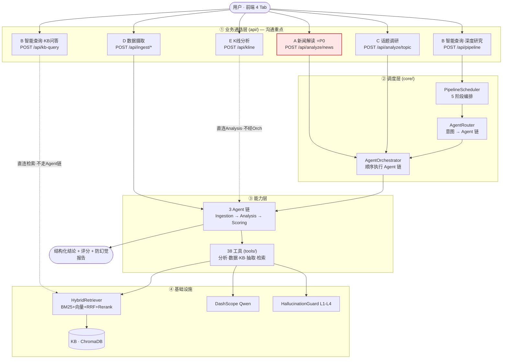

# FinRAG 架构基准

> **本文件是项目唯一架构文档**（2026-10 重写，取代已删除的 ARCHITECTURE_CN / AGENT_TOOLS / PROJECT_QA / USER_GUIDE）。
> 纪律：**代码即真理**。本文与代码冲突时以代码为准，并立即修正本文。任何调度层/通路改动必须同步本文件。

---

## 1. 项目定位

面向 AI/科技行业的金融智能分析系统（意图感知多智能体 RAG）。
核心业务：**新闻解读**（最高优先级）、话题调研、K线技术分析、知识库问答。
技术栈：FastAPI + DashScope(Qwen) + ChromaDB + 自研 HybridRetriever + LightRAG 图谱。

## 2. 总体架构

```
┌─ 前端 (static/) ─────────────────────────────────────────────┐
│  4 Tab: 系统概览 | 数据管理 | 智能查询 | 深度分析              │
│  index.html + app.js + modules/(9个ES模块)                   │
└──────────────────────────┬───────────────────────────────────┘
┌─ API 层 (api/) ──────────▼───────────────────────────────────┐
│  analysis_router | kb_router | ingest_router | query_router  │
│  app_state: 全局单例 (_state: llm/retriever/registry/        │
│             orchestrator/scheduler/filler/conversation_mgr)  │
└──────────────────────────┬───────────────────────────────────┘
┌─ 调度层 (core/) ─────────▼───────────────────────────────────┐
│  AgentRouter     意图分类(关键词+正则) → Agent 链             │
│  PipelineScheduler  5阶段: Fetch→Index→Process→Output→Evolve │
│  AgentOrchestrator  顺序执行链 + AgentContext 数据流          │
└──────────────────────────┬───────────────────────────────────┘
┌─ Agent 层 (agents/) ─────▼───────────────────────────────────┐
│  IngestionAgent → AnalysisAgent → ScoringAgent   (共3个)     │
│  Agent 只做编排，重活全部 call_tool() 委托                    │
└──────────────────────────┬───────────────────────────────────┘
┌─ 工具层 (tools/) ────────▼───────────────────────────────────┐
│  FunctionRegistry: 38 tools / 12 模块 / 5 分类               │
└──────────────────────────┬───────────────────────────────────┘
┌─ 基础设施 ───────────────▼───────────────────────────────────┐
│  retrievers/ 混合检索(BM25 FTS5+Chroma+RRF+Rerank+扩词)      │
│  llm/ DashScope客户端+ModelRouter   guard/ L1-L4防幻觉        │
│  services/ 分析·会话·持久化          slot_filler+templates    │
└──────────────────────────────────────────────────────────────┘
```

## 3. 业务通路（P0 — 一切工作围绕这些通路）

### 业务实现总览图（Mermaid，IDE 预览可渲染）



> **看图说话**：5 条业务通路从 API 入口进来 → 调度层决定走哪条 Agent 链 → 3 Agent 顺序执行、把重活委托给 38 工具 → 工具落在检索/LLM/防幻觉/KB 基础设施上 → 产出结构化结论+评分+防幻觉报告。
> ⭐ **A 新闻解读是 P0**（红框）；实线=走 Orchestrator 编排，虚线=旁路（KB问答直连检索、K线直连 AnalysisAgent）；深度研究(Bp) 独有 5 阶段 Pipeline。

### 通路 A：新闻解读 ⭐ 最高优先级
```
POST /api/analyze/news (analysis_router.py)
  → _run_analysis_via_agent_chain(intent="news", parsed_data=[{text}])
    → orchestrator.set_pipeline(["AnalysisAgent","ScoringAgent"]).execute()
      → AnalysisAgent._run_deep_news_chain → call_tool("analyze_news_deep")
        (内部: KB检索 grounding + LLM 结构化分析 → verdict/key_signals/impact/risks/watch_next)
      → ScoringAgent → evaluate_pipeline_quality ‖ check_hallucination → generate_score_report
  → 链失败 fallback: services/analysis.analyze_news_text + 独立 guard 校验
  → 后处理: 创建会话(conversation_manager) + 分析结论存入 KB
```

### 通路 B：智能查询（双模式）
```
KB问答:   POST /api/kb-query (kb_router.py)
  → retriever.search 混合检索 → LLM 生成带 [N] 引用答案
  → PipelineScoreCard + HallucinationGuard(mode=rag) 直连（不走 Agent 链）
深度研究: POST /api/pipeline (query_router.py)
  → scheduler.run() 5阶段:
    1 Fetch   FC会话选数据工具拉新闻 (需 LLM)
    2 Index   TextPreprocessor 清洗 → retriever 入库+检索
    3 Process AgentRouter.route(query) → 动态链 → orchestrator.execute()
    4 Output  SlotFiller 槽位填充（Agent 已有输出则跳过）
    5 Evolve  ScoreCard 打分 + Guard 防幻觉（报告追加到输出尾部）
```

### 通路 C：话题调研
```
POST /api/analyze/topic → _run_analysis_via_agent_chain(intent="deep_topic")
  → AnalysisAgent._run_deep_topic_chain → call_tool("analyze_topic_deep")
  ⚠️ deep_topic 不在 AgentRouter 意图表里，由 API 直接注入（历史旁路）
```

### 通路 D：数据摄取
```
新闻:  POST /api/ingest/news → tools/news_tools.run_news_pipeline
       (RSS/同花顺/新浪/东财 → 元数据 news_metadata.json；优质新闻入 KB)
文件:  POST /api/ingest/files | /api/ingest/upload (拖拽上传)
       → IngestionAgent: JSONL/TXT/PDF(PyMuPDF)/图片(qwen-vl) →
         清洗 → 相关性门控 → 分类 → extract_document_metadata → KB
       → PDF/图片解析内容另送 LightRAG 图谱抽取实体关系
```

### 通路 E：K线技术分析
```
POST /api/kline → 直接实例化 AnalysisAgent (intent=kline)
  → analyze_kline(Tushare/模拟数据 + MACD/RSI/KDJ/BOLL) → generate_kline_analysis(LLM)
  ⚠️ 第三条编排入口（不经 orchestrator/不评分）
```

### 意图 → Agent 链映射（AgentRouter，core/agent_router.py）
| intent | 触发 | 链 |
|--------|------|-----|
| kline | 走势/MACD/涨跌… | Analysis → Scoring |
| event_impact | 利好/利空/大事… | Analysis → Scoring |
| report | 财报/营收/净利润… | Ingestion → Analysis → Scoring |
| news | 新闻/资讯/公告… | Ingestion → Analysis → Scoring |
| general | 兜底 (conf=0.5) | Ingestion → Analysis → Scoring |
| deep_topic | ⚠️ 仅 API 注入 | Analysis → Scoring |

链的真实区分度只有"是否带 Ingestion"；行为差异由 `metadata.intent` 驱动
AnalysisAgent 内部工具链分发（`_run_kline_chain` / `_run_event_chain` /
`_run_deep_news_chain` / `_run_deep_topic_chain` / `_run_extraction_chain`）。

## 4. 调度层执行语义

- **AgentContext**：raw_input / parsed_data / extracted_features /
  intermediate_findings / final_answer / metadata，Agent 间唯一数据通道。
- **context_updates 合并规则**（orchestrator._apply_updates）：
  dict 字段 merge、list 字段 extend、标量覆盖；未知 key 落入 metadata。
- **ScoringAgent 通用接口**：上游经 metadata 传
  `scoring_source_items` / `scoring_mode`("rag"|"analysis") / `scoring_text` 三字段即可接入评分。
- **防幻觉**：guard/reflector.HallucinationGuard，运行时 L1-L4 确定性规则层（零 LLM、四层恒跑），
  RAG 模式查 `[N]` 引用，analysis 模式查 `【】` 结构；深度语义评判（LLM-as-judge）已前移到
  离线 eval/ragas_judge.py（RAGAS faithfulness），旧 L5/L6 LLM 层已淘汰删除。
- **可观测性**：observability/tracing.observe_span —— Phoenix/OpenInference 埋点收口（横切关注点，
  默认关闭走 no-op、未装 OTLP 导出器不报错）。第一期覆盖核心 RAG 链路：LLM(`llm/caller`)、
  检索(`retrievers/hybrid_engine.search`)、embedding/rerank(`llm/dashscope_client`)；
  启动挂载在 `core/factory.setup_environment`（PHOENIX_ENABLED=true 时 `init_phoenix` 配置
  OTLP/HTTP 导出器，把 span 推到**外部独立运行**的 Phoenix collector `/v1/traces`）。Phoenix
  服务隔离在独立 `.venv-obs`（`arize-phoenix` 与主运行时硬性冲突，不进主环境）；主环境仅需
  opentelemetry-sdk（core）+ otlp-http-exporter（`observability` extra）。

## 5. Agent 清单（3 个，agents/）

| Agent | 职责 | 调用的工具 |
|-------|------|-----------|
| IngestionAgent | 文件/文本/目录摄取，清洗+门控+分类+元数据 | extract_document_metadata, detect_document_type, parse_pdf_file, describe_image_file |
| AnalysisAgent | 按 intent 分发 5 条工具链，渲染 Markdown | analyze_kline, generate_kline_analysis, fetch_date_events ‖ fetch_kline_context, assess_event_impact, analyze_news_deep, analyze_topic_deep, extract_financial_metrics ‖ extract_entities, generate_search_queries, synthesize_report |
| ScoringAgent | 全链路评分 + 防幻觉（所有链末端） | evaluate_pipeline_quality ‖ check_hallucination, generate_score_report |

（‖ = ThreadPoolExecutor 并行调用）

## 6. 工具清单（38 个 / 12 模块 / 5 分类，tools/）

| 分类 | 数量 | 工具 |
|------|------|------|
| analysis | 14 | analyze_news_deep, analyze_topic_deep, analyze_kline, generate_kline_analysis, assess_event_impact, synthesize_report, calculate_growth_rate, calculate_financial_ratio, compare_metrics, summarize_financials, evaluate_pipeline_quality, check_hallucination, generate_score_report, answer_followup |
| data | 9 | fetch_stock_news, fetch_financial_news, fetch_announcements, fetch_news_report, fetch_date_events, fetch_kline_context, fetch_kline_report, parse_pdf_file, describe_image_file |
| kb | 7 | kb_load, kb_save, kb_add, kb_remove, kb_stats, chunk_document, chunk_documents_batch |
| extraction | 5 | extract_document_metadata, detect_document_type, extract_financial_metrics, extract_entities, generate_search_queries |
| retrieval | 3 | search_financial_data, query_knowledge_graph, get_graph_stats |

模块文件：core / analysis_tools / news_tools / kline_tools / event_impact_tools /
kb_tools / chunk_tools / extraction_tools / document_parse_tools / report_tools /
scoring_tools / graph_tools / conversation_tools（LLM 依赖经 inject_* 函数注入）。

## 7. 基础设施

- **retrievers/**（详见模块内 README）：HybridRetriever = BM25(SQLite FTS5 增量) +
  Chroma 向量 + RRF 融合 + qwen3-rerank + 查询扩展(词典 64 同义组/35 概念映射)；
  QueryPlanner(LLM 拆解复杂查询, 预留 source=graph)；TextChunker 按 doc_type 选策略
  (news 不切/长文按段落)；metadata.py 定义 DocMetadata schema + Chroma 白名单；
  lightrag_adapter 图谱检索。
- **llm/**：DashScopeLLM + LLMCaller(重试/缓存/JSON 平衡括号解析) + ModelRouter(4 档模型)。
- **services/**：analysis(新闻/话题分析 fallback 实现)、conversation(会话管理)、persistence(KB 持久化)。
- **数据**（data/knowledge_base/ 按“能否再生”分三层，路径统一由 config.kb_dir 派生，详见 data/README.md）：
  source/(真相源·不可再生·入库) kb_docs.json、news_metadata.json、news_archive.jsonl；
  index/(派生索引·可删重建·不入库) kb_index.json、bm25_index.db、chroma/、embedding_cache.json、lightrag/；
  state/(运行状态·可删·不入库) stats.json、.kb_version、conversations/、learning/。

## 8. 已知问题 & Backlog（业务通路优先，其余降级）

### P0 — 影响通路正确性（新架构跑通前必须处理）
1. **编排器并发竞态**：orchestrator 是共享单例，`set_pipeline()`+`self.context` 为可变全局状态，并发请求互相覆写链与上下文（orchestrator.py L128/L151 ↔ pipeline.py L360 ↔ analysis_router.py L151）。
2. **防幻觉静默跳过**（可靠性层会被无痕绕过）：① `ScoringAgent.can_handle=bool(final_answer or intermediate_findings)`（scoring_agent.py L51-53），上游忘写回 final_answer → orchestrator 无痕 continue，整层评分+防幻觉消失且无"未校验"提示；② `check_hallucination` 中 `if not check_text: return {}`（L101-102）→ 空文本静默跳过。方向：can_handle 兜底 + 空文本走显式 skipped 标记。**用户 2026-10 拍板：先记录，暂不动代码。**
3. **检索 grounding 被腰斩，RAG 名不副实**（探针实测）：深度分析路径把 KB 背景砍到 `kb_sources[:3]` 且每条 `s['text'][:150]`（analysis.py L388/L512）—— 实测 3286 字 chunk 只喂 450 字（**保真率 13.7%**）且断在半句。后果：AI 拿不到真实上下文 → 幻觉温床；Guard 又用同一批残片当 grounding 打分 → **防幻觉分数系统性虚高、自我欺骗**。方向：grounding 统一走 ReliabilityService（见 P1-5），按 token 预算而非固定 150 字截断。
4. **embedding 缓存 `text[:500]` 撞键 → 向量污染**（探针实测，静默数据损坏）：缓存键 `MD5(text[:500])`（embedding_cache.py L200），两 chunk 前 500 字相同（模板抬头/免责声明）即同 hash → 后者复用前者 embedding → 存进错误向量、检索召回错内容。方向：hash 用全文或 (source_id+chunk_id)。

### P1 — 通路跑通后第一批清理
5. **可靠性入口收敛 → 抽 ReliabilityService**（用户 2026-10 拍板·待开工）：`HallucinationGuard.check()` 现有 **4 个各自为政的调用点**（① scoring_tools.check_hallucination ② analysis_router._run_hallucination_check 硬编码 mode=analysis ③ kb_router /kb-query 默认 mode=rag ④ pipeline._phase_evolve），每处自拼 sources+自定 mode+自决触发 → 同一输出分数不可复现、通路 B 上双重评分、改策略需同步 4 处易漂移。方向：抽 `ReliabilityService` 封装 check()+mode 决策+source 组装+序列化，其余 3 处及 ScoringAgent 均复用。
6. **假分数 + L1 语义反转盲点**：`evaluate_pipeline_quality`/`_phase_evolve` 硬编码 0.9/0.85/0.8（scoring_tools.py L63/70/79，"有数据即高分"）→ pipeline_grade 系统性虚高，应换真实质量信号（RAGAS 基线已建）。另 L1 来源锚定 token 重叠 ≥0.30 即算锚定（rule_layers.py GROUNDING_THRESHOLD，Step7 已从 0.15 提到 0.30），但**语义反转仍未解**（"下降15%"vs"增长15%"因 token 高度重叠被误判已锚定）；方向：词级极性/方向校验。
7. 重试机制失效：BaseAgent.run 吞掉所有异常，orchestrator 的 max_retries 永不触发。
8. 三条 AnalysisAgent 入口（链 / _run_analysis_via_agent_chain / api_kline 直连）收敛为一条。
9. **数据存储迁移到 PostgreSQL**（用户 2026-10 拍板·待开工）：根治内存单例整表重写+无锁并发丢数据（news_metadata 曾 -1361 行）与四份真相计数校验。核心先行——kb_docs/news_meta/stats/version 入 PG 做唯一真相，Chroma/LightRAG/bm25 降为可重建派生索引；`persistence.py` 换实现留签名（~18 处调用点零改动）；前置需 PG 实例+驱动+Alembic+config/.env。
10. **检索→组装三套截断 + 三套 prompt 不一致**（探针实测）：同一 KB chunk 走不同通路信息量差 5 倍以上（KB问答不截断 / 深度分析每条 150 / 新闻综合每条 800 总 12000）；prompt 亦分裂三套（prompts.py 富模板 / analysis.py 内联 L390-448 / slot_filler 极简 L96-99）→ 输出不可复现+维护漂移。方向：截断收敛到统一 context-builder，prompt 统一到 prompts.py。
11. **槽位填充碎片化推理**（"快"换"深"的副作用）：QUICK_QA 每槽 `max_tokens` 30-100、独立并行、system 极简（templates.py L178-211），首 token 延迟压到 0.3-0.8s，但 100 token 预算**承载不了连贯深度分析**。方向：区分"快答/深度"两档，深度档放开 token 或改单次长生成。
12. **分块配置三处散落**：factory(1500/100/80/skip500) vs chunk_tools "default"(500/50, L28-44) vs kb_router(`TextChunker(chunk_size=req.chunk_size)` 直接 `.split`, L555)，`chunk_document` 工具与真正入库用的 size 不同。方向：单一 chunk 配置源（并入 config.py）。

### P2 — 历史债（明确降级，不阻塞业务）
13. **chunk 边界/位置追溯损坏**（探针实测）：`_add_overlap` 拼接后 `text.find(chunk[:20])` 定位失效（内容重复指向错误位置、位移返回 -1，chunker.py L117-124）；`_merge_small_chunks` 无分隔符拼残片（L273）；overlap 后 chunk 超 chunk_size（实测 1534>1500）；news=(500,0) 无重叠致长新闻边界断裂。
14. 死代码：ExecutionMode.PARALLEL/CONDITIONAL、MessageBus(protocol.py)、data_orchestrator 多Pool分支、_route_query fetched_date 死信号。
15. orchestrator.history 无界增长；tool call ID 秒级时间戳会撞。
16. 同步+线程池架构 → async 化；verbose print → logger。
17. IngestionAgent EXPECTED_METADATA_FIELDS 与 DocMetadata schema 脱节（fiscal_period/currency 财报时代残留）。
18. AgentRouter 关键词正则分类 → LLM/Planner 路由；公司名硬编码正则与 STOCK_MAP 双份维护。
19. 测试套件对齐：旧架构约 594 用例全量套已废弃，替换为护栏驱动按 RAG 流水线步骤测试（当前 372，覆盖预处理/入库/查询解析/召回/RRF融合/过滤门控/生成有据化 + 上下文组装 + 追问质量闭环 + Prompt契约锁 + 槽位输出引擎 + 导入状态可观测性 + L1检索评估 + L2输出评估 + L3 LLM-as-judge(RAGAS) + 可观测性埋点，Step 0-7 已闭环，详见 README）；仍待按 5 条业务通路对齐端到端；加固期 CI 门禁手动触发。
20. 可观测性：Phoenix 选型已定（OpenInference/OTel，独立 `.venv-obs` + 主应用 OTLP/HTTP 外推，默认关闭）；第一期核心 RAG 链路（LLM/检索/embedding/rerank）已落地，第二期（Agent 链/Pipeline 5 阶段/工具调用/护栏）尚未埋点。
21. 依赖治理：已迁移 uv + PEP 621 `pyproject.toml`（单一真相源）+ `uv.lock`（可复现）；移除全项目 0 引用的 `llama-index`（曾拖进 openai<3 生态、与 Phoenix 冲突）；分 core/dev/observability 三组 extras；`arize-phoenix` 隔离独立 `.venv-obs`；`requirements.txt` 为 `uv export` 锁定产物；CI 用 setup-uv + `uv sync --frozen`。
22. **RAGAS LLM-as-judge 辅助观测**（六层防护退役后新增，用户 2026-11 拍板降级为辅助观测）：① **judge 区分度已修复**——原默认英文 prompt 致中文声明翻译扭曲（主语错绑/过度拆分）、good−defect mean-gap 仅 0.04-0.06（远低于 0.15）；中文化两步 prompt 后 gap 抬到 **0.18 越过 0.15 阈值**（good_mean 0.87/defect_mean 0.68，两次复现，见 `eval/ragas_judge.py` `_build_cn_faithfulness_prompts`）。仍定位辅助观测（跑通 exit 0、区分度仅报告不阻断），主门禁靠 L1/L2 规则尺子 + step7。② **golden 集单一**——`output_news_brief.jsonl` 11 case 全部共用 1 篇源文档 `d_sensetime_long`，L2/L3 尺子判别力/泛化性受限、有过拟合风险。③ `extract_brief_claims` 只适配 NEWS_BRIEF 模板，deep_analysis/quick_qa 走不通。④ RAGAS 需 API key+重依赖、不进 CI、在线评判无回归保护。方向：扩 golden 到多源/多模板 + gap 在线波动取多次均值 + 查 compute_03 中文化后退步(1.0→0.667)。

## 9. 测试与运行

```cmd
uv sync --extra dev                       # 建 .venv，按 uv.lock 精确复现
.venv\Scripts\activate.bat
python -m financial_rag.main web        # Web UI: http://127.0.0.1:8000
pytest tests -q                          # 372 用例, 护栏驱动按流水线步骤, 离线 <7s
```

Mock 约定：只 mock 数据源 API（Tushare/RSS）；conftest 的 autouse fixture `_force_local_retrieval` 删除 DASHSCOPE_API_KEY，强制检索走本地（BM25+Jaccard），保证确定性、离线、可复现。LLM/Embedding/Rerank 仅在测试显式调用时才真实。

> 迭代期约定：暂停把全量 `pytest` 当改动门禁（见 §8 P2-19）；需要验证时只对当前正在改的通路做轻量探针（`python -c` 导入/冒烟）。
